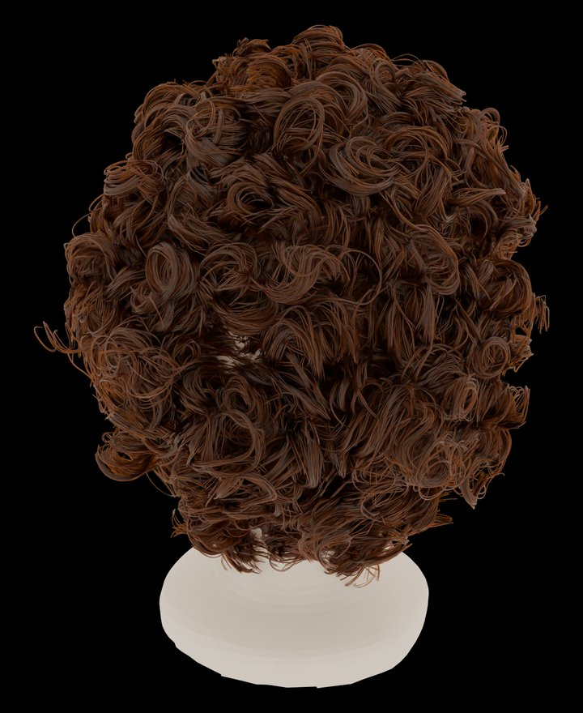
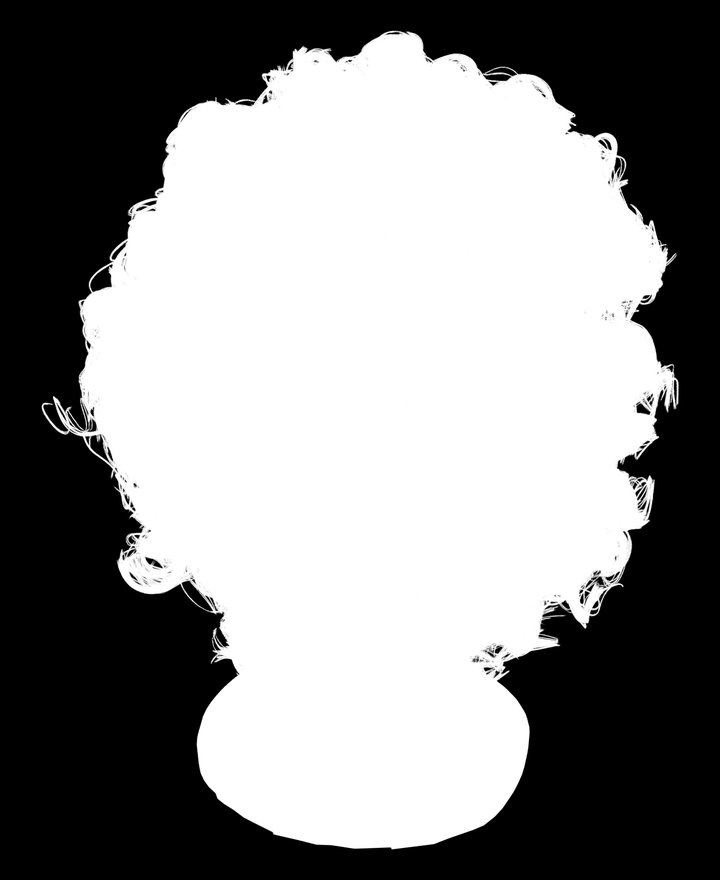
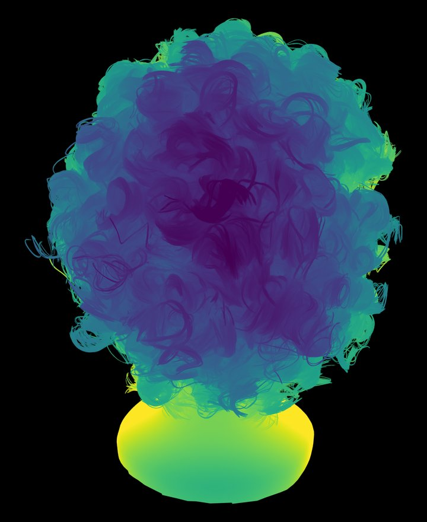
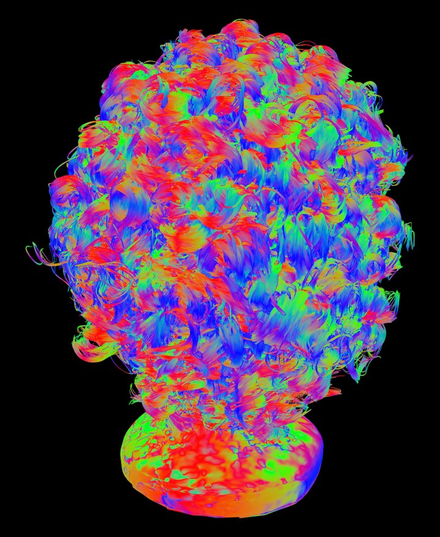
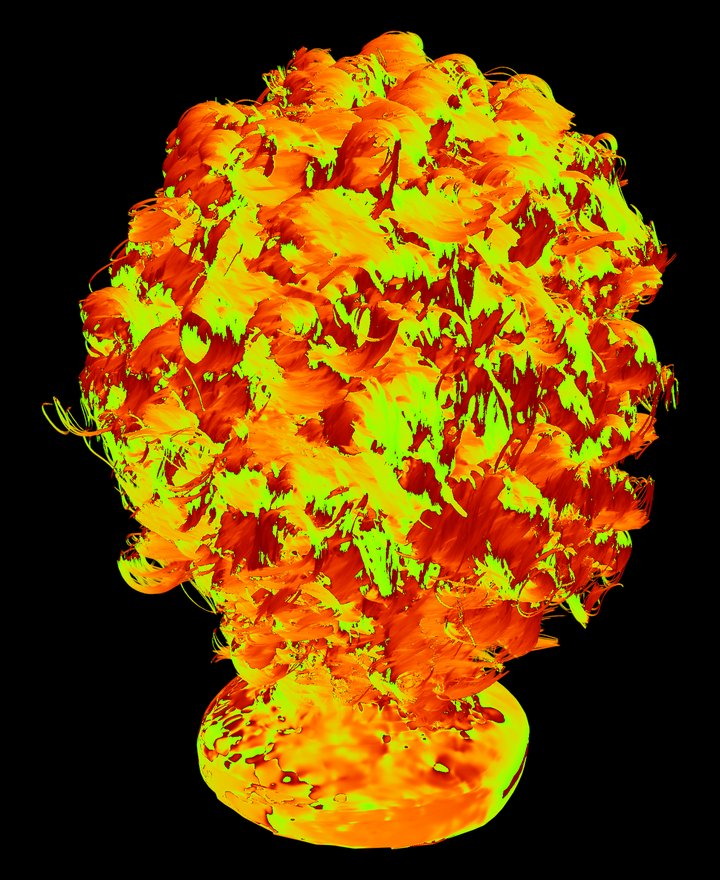
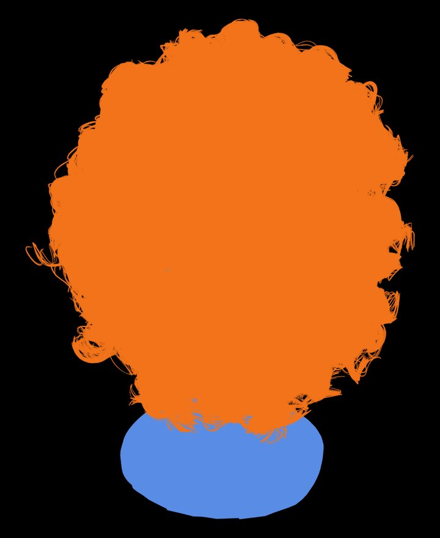

# Strand-Surfels

Hair strand reconstruction from multi-view images with 2D Gaussian surfels.

Strand-Surfels is stage 1 of the hair reconstruction pipeline described in
[STITCH: Structure Tensor Informed Topologically Coherent Hair Reconstruction](https://doi.org/10.1111/cgf.70640)
(Computer Graphics Forum). Stage 0, line-based multi-view stereo (LPMVS), is
released in [SMHC-Unofficial-Pytorch](https://github.com/Allrez/SMHC-Unofficial-Pytorch).


## Installation

Requirements: Linux, an NVIDIA GPU, and [conda](https://docs.conda.io).
The conda environment provides PyTorch 2.4 and the CUDA 12.4 toolkit that is
used to compile the CUDA extensions.

```bash
# 1. create and activate the environment
conda env create -f environment.yml
conda activate strand-surfels

# 2. fused-ssim (CUDA extension, compiled against the installed PyTorch)
pip install --no-build-isolation \
    "git+https://github.com/rahul-goel/fused-ssim@a7c48d6dd7ac6dc39a7958c7c4452e0b10418f38"

# 3. Strand-Surfels itself (also compiles CUDA extensions)
pip install --no-build-isolation -e .
```

`--no-build-isolation` is required so that the extensions are built against
the PyTorch installed in the environment.

## Pipeline overview

Strand-Surfels runs on the results of stage 0 of the STITCH pipeline:

0. **Line-based multi-view stereo (LPMVS, stage 0).** The input images are first
   processed with [SMHC-Unofficial-Pytorch](https://github.com/Allrez/SMHC-Unofficial-Pytorch),
   which estimates 2D hair orientation maps, runs line-based PatchMatch
   multi-view stereo (LPMVS), and keeps only the estimates that are consistent
   across neighbouring views (line filtering). Strand-Surfels uses two of its
   outputs:
   - `int/int_map_XXXXXX.npy`: one `H × W × 3` float32 map per view. Where
     the estimate is multi-view consistent, the channels are
     `depth | dir.x | dir.y` (the 3D strand direction, with `dir.z ≥ 0`
     recovered from the unit norm). Otherwise the depth is `-1` and the other
     two channels hold the 2D orientation angle and its confidence.
   - `filtered/filtered_positions.npy` and `filtered/filtered_directions.npy`:
     the consistent estimates of all views gathered into a point cloud
     (`N × 4` each: `x y z depth` and `dx dy dz gray`). These initialise the
     surfels.
1. **Strand surfel optimisation (stage 1, this repository).** 2D Gaussian surfels are
   optimised against the input images, with an additional geometry loss
   that ties their depth and strand direction to the SMHC estimates.

Run SMHC on your dataset first (see its README), then point Strand-Surfels at
the dataset and at the SMHC output folder.

## Data layout

Input data and generated outputs are kept in separate folders:

```
data/<scene>/                      # input dataset
├── calibration.json               # per camera: OpenCV intrinsics (K) and world-to-camera extrinsics
├── image/img_XXXXXX.png           # RGB input images
├── hair/img_XXXXXX.png            # hair segmentation masks
└── body/img_XXXXXX.png            # optional foreground (alpha) masks

output/<scene>/                    # SMHC outputs, Strand-Surfels writes its results here too
├── int/int_map_XXXXXX.npy
└── filtered/
    ├── filtered_positions.npy
    └── filtered_directions.npy
```

Cameras follow the OpenCV convention: x to the right, y down, and the camera
looking along +z.

Without `body/` masks, the foreground is taken from the images: every pixel
that is not pure black (scenes captured or rendered on a black background).
`--foreground-threshold` raises this threshold (0–255), and a negative value
treats every pixel as foreground.

## Training

```bash
strand-surfels-train --data data/<scene> --smhc output/<scene> --run output/<scene>/run1
```

The run folder receives the surfel point clouds
(`point_cloud/iteration_<i>/point_cloud.ply`), checkpoints
(`checkpoint/chkpnt<i>.pth`, resume with `--start-checkpoint`), the
configuration used (`config.yaml`) and TensorBoard logs.

In each surfel PLY, `nx`, `ny`, and `nz` store the world-space unit strand
tangent. The 8-bit `red`, `green`, and `blue` vertex properties show its
orientation using FURY's `boys2rgb` colormap.

The settings are read from [configs/splatting_cfgs.yaml](configs/splatting_cfgs.yaml)
(or `--config`), and every entry can be overridden on the command line by its
dotted name, e.g. `--optimization.iterations 30000` or
`--optimization.save_iterations 7000 30000`.

The optimisation follows 2D Gaussian Splatting, with:

- **Losses:** a photometric loss (L1 and SSIM), an alpha loss against the
  foreground masks, depth distortion, and the geometry loss against the SMHC
  results inside the hair masks: depth and 3D strand direction where SMHC is
  multi-view consistent, and the image-space orientation of the projected
  strands elsewhere.
- **Densification:** score-based densification under a growing surfel budget
  ([Taming 3DGS](https://humansensinglab.github.io/taming-3dgs/)), with the
  opacity correction and opacity decay of
  [Revising Densification in Gaussian Splatting](https://arxiv.org/abs/2404.06109).
- **Optimizer:** sparse Adam, which updates only the surfels visible in the
  current view.

With a display, the optimisation can be watched in the viewer (see below). Use
`--viewer off` to disable it.

### Timing and memory

Training on the synthetic jewfro model from CT2Hair: 136 views at 2048×2048,
155k initial surfels and about 375k after training. The runs used the default
configuration, `--viewer off`, an NVIDIA RTX 3090 (24 GB), an AMD Ryzen 9 5950X,
PyTorch 2.4.1 and CUDA 12.4.

| Hair labels | Time to 7k iterations | Time to 15k iterations | Peak RAM | Peak VRAM (PyTorch allocated / reserved) | Peak VRAM (`nvidia-smi`) |
|---|---|---|---|---|---|
| on (default) | 5 min 14 s | 11 min 49 s | 10.7 GiB | 3.5 / 3.7 GiB | 4.0 GiB |
| off | 4 min 55 s | 11 min 07 s | 10.7 GiB | 3.5 / 3.6 GiB | 3.9 GiB |

The times cover the training loop, including the evaluation and saving at
7k and 15k iterations, but not loading the dataset. 
Most of the RAM usage is to load the dataset, which is
kept in host memory, about 71 MB per 2048×2048 view. It grows with the number of views and their resolution, and it can be reduced by the 
`images_resolution` in the configuration.

### Hair labels (later addition)

> Hair labels were added after the STITCH publication. They are not part of the
> method described in the paper and were not used for its results.

Each surfel also learns a hair label: the probability that it represents
hair rather than the body, head or clothing. This makes it easy to separate
the hair surfels from the rest. The labels are learned from the hair masks.
Every `labels.interval` iterations (default 10), the current view is rendered
a second time with the label as colour and the geometry held fixed, and the
blended label is compared with the hair mask. Only the labels receive
gradients from this loss, so they don't change the other surfel parameters
or the densification. Cloned and split surfels inherit their label.

The labels are stored as the `label` property (a logit probability
`sigmoid(label)`) in the point cloud files, and the evaluation reports the
intersection over union of the rendered hair and the hair masks. The settings
live in the `labels` section of the configuration (`--labels.enabled false`
turns the labels off, also `--labels.weight`, `--labels.lr`,
`--labels.interval`). Point clouds without labels can still be loaded.

## Viewer

Surfels can be inspected interactively with a [Polyscope](https://polyscope.run)
viewer, both during training and afterwards. To view an optimised point cloud
together with the dataset cameras:

```bash
strand-surfels-view output/<scene>/point_cloud/iteration_15000/point_cloud.ply \
    --calibration data/<scene>/calibration.json
```

The viewer renders the surfels from Polyscope's camera with the CUDA
rasterizer and offers the following modes:

<table>
  <tr>
    <td align="center" width="33%"><br><b>RGB</b><br><sub>rendered colors</sub></td>
    <td align="center" width="33%"><br><b>Alpha</b><br><sub>accumulated opacity</sub></td>
    <td align="center" width="33%"><br><b>Depth</b><br><sub>expected (or median) depth, color mapped</sub></td>
  </tr>
  <tr>
    <td align="center" width="33%"><br><b>Direction 3D</b><br><sub>world space strand direction, <code>abs(d)</code> as RGB</sub></td>
    <td align="center" width="33%"><br><b>Orientation 2D</b><br><sub>image space orientation of the projected strands, as used by the geometry loss</sub></td>
    <td align="center" width="33%"><br><b>Hair label</b><br><sub>blue: other, orange: hair (later addition)</sub></td>
  </tr>
</table>

<sub>Reconstruction of the "Jewfro" hair model of the
[CT2Hair](https://github.com/facebookresearch/CT2Hair) dataset after 15,000
iterations, seen from one of the training cameras. The images are licensed
under CC BY-NC 4.0, like the CT2Hair data (see
[THIRD_PARTY_NOTICES.md](THIRD_PARTY_NOTICES.md)).</sub>

When the surfels have hair labels, the viewer can also show the hair surfels
only or the other surfels only, with an adjustable probability threshold.
On machines without a display the viewer is disabled and training runs
headless.

During training the viewer refreshes every 0.1 s by default (adjustable in the
UI), and training can be paused and stepped from the UI.

## Citation

If you use Strand-Surfels in your research, please cite:

```bibtex
@article{https://doi.org/10.1111/cgf.70640,
  author  = {Vafaei, Alireza and Spindler, Jan and Dröge, Hannah and Plack, Markus and Stotko, Patrick and Klein, Reinhard},
  title   = {STITCH: Structure Tensor Informed Topologically Coherent Hair Reconstruction},
  journal = {Computer Graphics Forum},
  doi     = {10.1111/cgf.70640}
}
```

## License

Strand-Surfels is released under the [MIT License](LICENSE).
Third-party code and dependencies are listed in
[THIRD_PARTY_NOTICES.md](THIRD_PARTY_NOTICES.md).
